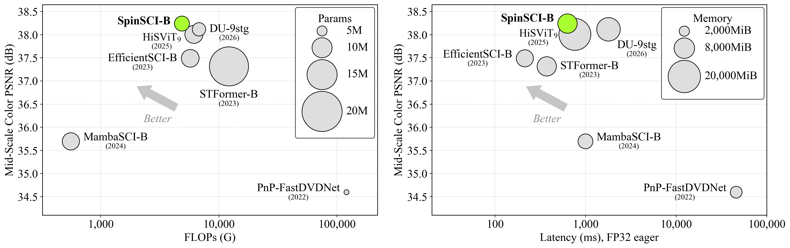
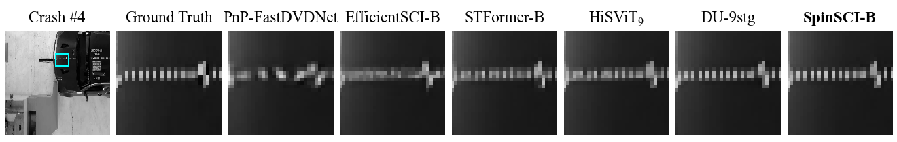
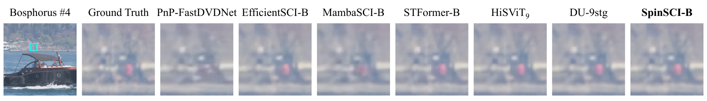
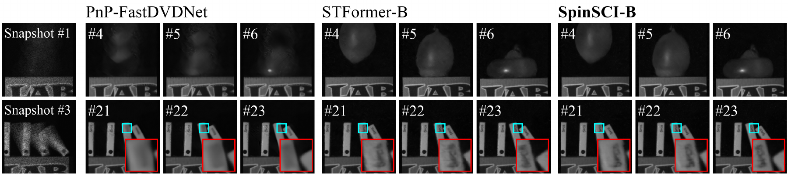
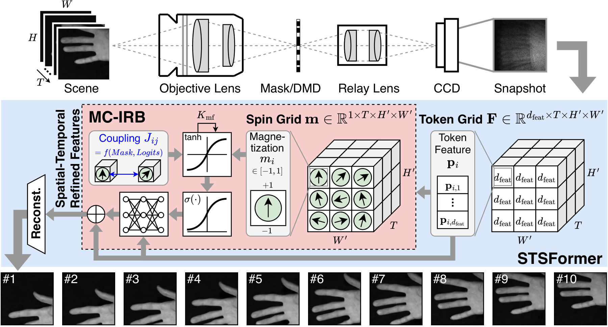
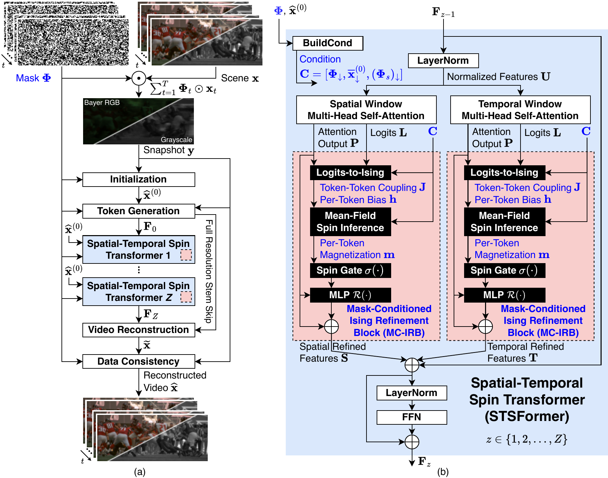

# SpinSCI: Mask-Conditioned Spatial-Temporal Spin Transformer for Video Snapshot Compressive Imaging

Official PyTorch implementation of **SpinSCI**, with training and evaluation code, four reference checkpoints, and benchmark inference masks.

By **Seungki Hong**, **Zhishuai Zhang**, and **Taekwang Jang**<br>
ETH AI Center, ETH Zurich

[](https://arxiv.org/abs/2611.11753)
[](https://github.com/skethz/SpinSCI)
[](checkpoints/)
[](#results)

> **Abstract:** Video snapshot compressive imaging (SCI) recovers multiple frames from one spatiotemporally coded measurement. This paper proposes *SpinSCI*, a mask-conditioned Spatial-Temporal Spin Transformer whose *Mask-Conditioned Ising Refinement Block (MC-IRB)* combines attention logits and sensing information to form signed spin couplings. Finite mean-field updates gate residual feature refinement. Physics-guided initialization and final data consistency incorporate the measurement model. Compared with HiSViT<sub>9</sub>, SpinSCI achieves average PSNR gains of **0.51 dB**, **0.23 dB**, and **0.04 dB** on *small-scale gray, mid-scale color, and large-scale color benchmarks*, respectively, with **16.9% fewer parameters, 20.9–21.6% fewer FLOPs, 17.1–49.9% lower FP32 eager latency, and 62.3–63.3% lower peak memory**. Relative to DU-9stg, average PSNR differs by at most **0.13 dB** across these benchmarks, with **28.2–28.7% fewer FLOPs, 64.6–71.7% lower inference latency, and 30.1–35.0% lower peak memory**. Qualitative comparisons on the *real benchmark* further show recovery of fine details and textures.

<p align="center">
  
</p>

*Mid-scale color PSNR versus FLOPs (left) and FP32 eager latency (right). Circle diameter represents parameter count on the left and circle area represents peak allocated memory on the right. Measurement settings are described in [Results](#results) and the [reproduction guide](docs/reproduction.md#efficiency-profiling).*

## 📑 Contents

1. [Environment](#environment)
2. [Installation](#installation)
3. [Pretrained Models](#pretrained-models)
4. [Inference Masks](#inference-masks)
5. [Inference](#inference)
6. [Training](#training)
7. [Testing](#testing)
8. [Results](#results)
9. [Visual Results](#visual-results)
10. [Model Overview](#model-overview)
11. [Reproducibility](#reproducibility)
12. [Citation](#citation)

## <a name="environment"></a> 📢 Environment

- Python 3.11 and PyTorch 2.10.0 were used for the reference GPU measurements.
- CUDA 13.0 on an NVIDIA GH200 was used for efficiency profiling; training uses four NVIDIA H200 GPUs.
- A Linux CUDA environment with BF16 support is required for the compiled inference recipe. CPU execution with the standard PyTorch FFN path is available for functional checks.

## <a name="installation"></a> ⚙️ Installation

```bash
git clone https://github.com/skethz/SpinSCI.git
cd SpinSCI

conda create -n spinsci python=3.11 -y
conda activate spinsci

pip install -r requirements.txt
pip install -r requirements-benchmarks.txt
```

Use a CUDA-enabled [PyTorch installation](https://pytorch.org/get-started/locally/) appropriate for the GPU and driver. The Triton FFN uses Triton supplied with Linux PyTorch. `--ffn-impl cudnn` selects standard PyTorch convolutions with the same weights.

## <a name="pretrained-models"></a> 🧩 Pretrained Models

The four reference checkpoints are included in [`checkpoints/`](checkpoints/). CR denotes the compression rate.

| Model | Configuration | Checkpoint |
| --- | --- | --- |
| Gray, CR8 | [gray_cr8.json](configs/gray_cr8.json) | [spinsci_gray_cr8.pth](checkpoints/spinsci_gray_cr8.pth) |
| Color, CR8 | [color_cr8.json](configs/color_cr8.json) | [spinsci_color_cr8.pth](checkpoints/spinsci_color_cr8.pth) |
| Real gray, CR10 | [real_cr10.json](configs/real_cr10.json) | [spinsci_real_cr10.pth](checkpoints/spinsci_real_cr10.pth) |
| Real gray, CR50 | [real_cr50.json](configs/real_cr50.json) | [spinsci_real_cr50.pth](checkpoints/spinsci_real_cr50.pth) |

File hashes and weight selections are recorded in the [checkpoint manifest](checkpoints/manifest.json). Datasets are supplied separately; inference masks are included below.

## <a name="inference-masks"></a> Inference Masks

The original benchmark inference masks are included in [`masks/`](masks/) (38.8 MiB total). Each MATLAB file contains a `mask` array in `H,W,T` order.

| Benchmark | Mask | Shape | Sequences / frame selection |
| --- | --- | --- | --- |
| Small-scale gray, CR8 | [gray_cr8.mat](masks/gray_cr8.mat) | 256 × 256 × 8 | All six gray sequences |
| Mid-scale color, CR8 | [mid_color_cr8.mat](masks/mid_color_cr8.mat) | 512 × 512 × 8 | All six mid-color sequences |
| Large-scale color, CR8 | [large_color_1080x1920_cr8.mat](masks/large_color_1080x1920_cr8.mat) | 1080 × 1920 × 8 | Hummingbird, Messi, Swinger |
| Large-scale color, CR8 | [large_color_822x1920_cr8.mat](masks/large_color_822x1920_cr8.mat) | 822 × 1920 × 8 | Football |
| Real benchmark, CR10 / CR50 | [real_mask.mat](masks/real_mask.mat) | 512 × 512 × 50 | First 10 frames for CR10; all 50 for CR50 |

Simulated-benchmark masks are binary. The real mask contains calibrated floating-point values that must be retained without thresholding or rescaling. `tools.evaluate_benchmarks` selects the first `--frames` mask frames, so both real-data commands use the same file. Ground-truth videos and real measurements are supplied separately.

The [mask guide](masks/README.md) provides complete commands for every benchmark, including both large-color resolutions. File sizes, array types, and SHA-256 hashes are listed in the [mask manifest](masks/manifest.json).

## <a name="inference"></a> 🔧 Inference

Reconstruct real CR10 measurements in FP32 eager mode with the released real-data checkpoint:

```bash
export CUDA_VISIBLE_DEVICES=0

python -m tools.evaluate_benchmarks --model spinsci \
  --config configs/real_cr10.json --checkpoint checkpoints/spinsci_real_cr10.pth \
  --real --channels 1 --data-root /path/to/real_cr10 --mask masks/real_mask.mat \
  --frames 10 --layout gray --precision fp32 --save-raw \
  --output outputs/real_cr10
```

The command saves reconstruction arrays, PNG frames, and a summary in the output directory. For CR50, use `configs/real_cr50.json`, `checkpoints/spinsci_real_cr50.pth`, and `--frames 50` with the same mask. The shared evaluator applies `meas / 255 * (T / 2)` automatically; see [input layouts and scaling](docs/reproduction.md#input-layouts-and-scaling) for other inputs.

## <a name="training"></a> 🔩 Training

### Data preparation

Download [DAVIS2017](https://davischallenge.org/davis2017/code.html) and supply a sensing mask. The loader expects:

```text
DAVIS/
├── ImageSets/2017/train.txt
└── JPEGImages/480p/<sequence>/*.jpg
```

Only the official training split is used.

### Training commands

```bash
# Grayscale: global batch 10 across four GPUs.
torchrun --standalone --nproc_per_node=4 -m tools.train configs/gray_cr8.json \
  --davis-root /path/to/DAVIS --mask /path/to/gray_mask.mat \
  --output outputs/gray

# Color: global batch 2 across four GPUs.
torchrun --standalone --nproc_per_node=4 -m tools.train configs/color_cr8.json \
  --davis-root /path/to/DAVIS --mask /path/to/color_mask.mat \
  --output outputs/color
```

| Recipe | Crop | Global batch | Epochs |
| --- | --- | ---: | ---: |
| Gray | 256 × 256 | 10 | 200 |
| Color | 512 × 512 | 2 | 200 |

Training uses Muon for eligible matrix weights and AdamW with zero weight decay for the remainder, cosine decay from 2e-4 to 1e-6, final-reconstruction MSE, and BF16/FP32 mixed precision. See the [training guide](docs/reproduction.md#training) for sampling, exact global-batch handling, resume, and warm-start options.

## <a name="testing"></a> 🔨 Testing

### Data preparation

Supply the original benchmark MATLAB files, one per sequence, and select the matching [included mask](#inference-masks). The commands below use the [shared benchmark evaluator](docs/reproduction.md#shared-benchmark-evaluation-and-frame-export), which applies the fixed CACTI file orientations and divides values by 255. For other MATLAB/NumPy inputs, `tools.evaluate` accepts explicit layouts as described in [input layouts and scaling](docs/reproduction.md#input-layouts-and-scaling).

### Testing commands

```bash
export CUDA_VISIBLE_DEVICES=0

# Small-scale gray: full-frame FP32 eager inference.
python -m tools.evaluate_benchmarks --model spinsci \
  --config configs/gray_cr8.json --checkpoint checkpoints/spinsci_gray_cr8.pth \
  --channels 1 --data-root /path/to/gray --mask masks/gray_cr8.mat \
  --frames 8 --layout gray --precision fp32 --no-images \
  --output outputs/gray_eval

# Mid-scale color: full-frame FP32 inference.
python -m tools.evaluate_benchmarks --model spinsci \
  --config configs/color_cr8.json --checkpoint checkpoints/spinsci_color_cr8.pth \
  --channels 3 --data-root /path/to/mid_color --mask masks/mid_color_cr8.mat \
  --frames 8 --layout mid_rot90 --precision fp32 --no-images \
  --output outputs/color_eval
```

PSNR/SSIM use unclipped predictions and the RGGB mosaic for color. Metrics first average frames within each sequence, then weight sequences equally. Large-scale quality uses full-frame inference; run the [large-color commands](masks/README.md#benchmark-commands) separately for the 1080 × 1920 sequences and Football, then weight all four sequences equally. Omit `--no-images` to export PNG frames.

## <a name="results"></a> 📈 Results

### Reconstruction quality

Average **PSNR (dB) / SSIM** at compression rate 8. Best and second-best scores are bold and underlined.

| Method | Small-scale gray | Mid-scale color | Large-scale color |
| --- | ---: | ---: | ---: |
| PnP-FastDVDNet | 32.35 / 0.942 | 34.60 / 0.955 | 34.43 / 0.967 |
| EfficientSCI-B | 36.48 / 0.975 | 37.49 / 0.970 | 36.26 / 0.969 |
| MambaSCI-B | — | 35.70 / 0.959 | 30.92 / 0.859 |
| STFormer-B | 36.34 / 0.974 | 37.32 / 0.970 | 36.38 / 0.971 |
| HiSViT<sub>9</sub> | 37.00 / <ins>0.978</ins> | 38.01 / <ins>0.972</ins> | 37.64 / **0.980** |
| DU-9stg | **37.57** / **0.980** | <ins>38.12</ins> / **0.973** | **37.80** / **0.980** |
| **SpinSCI-B** | <ins>37.51</ins> / **0.980** | **38.24** / **0.973** | <ins>37.68</ins> / <ins>0.979</ins> |

Small-scale gray and mid-scale color baseline PSNR/SSIM values come from the respective papers. DU-9stg uses measured mid-color scores because its measured mean is 0.18 dB below the reported mean. Large-scale baseline quality uses official-checkpoint evaluations. MambaSCI is designed for quad-Bayer measurements and its paper does not report grayscale results, so its gray entry is omitted. The [DU comparison](docs/reproduction.md#du-9stg-comparison) lists reported and measured PSNR separately.

### SpinSCI computational cost

| Benchmark | Params (M) | FLOPs (G) | Latency (ms) | Peak memory (MiB) |
| --- | ---: | ---: | ---: | ---: |
| Small-scale gray | 7.47 | 1214 | 132 | 1850 |
| Mid-scale color | 7.47 | 4856 | 630 | 7151 |
| Large-scale color | 7.47 | 38402 | 4200 | 2424 |

All methods in the main-paper comparison use FP32 eager inference on an NVIDIA GH200 with batch size 1 and eight frames. One THOP module MAC counts as one FLOP. For every method, large-scale latency is estimated as 24 times the measured median for one tile. Peak memory is measured per tile. The [efficiency guide](docs/reproduction.md#efficiency-profiling) gives the profiling commands and exact values.

```bash
export CUDA_VISIBLE_DEVICES=0

python -m tools.profile_benchmarks --model spinsci \
  --config configs/color_cr8.json --checkpoint checkpoints/spinsci_color_cr8.pth \
  --case color512 --mode runtime --precision fp32 --warmups 3 --runs 10 \
  --output outputs/color_runtime.json
```

## <a name="visual-results"></a> 🔎 Visual Results

### Small-scale gray: Crash



### Mid-scale color: Bosphorus



### Real benchmark: Water Balloon and Domino



Real-benchmark comparisons include only methods with officially released checkpoints for real-data reconstruction.

## <a name="model-overview"></a> 📐 Model Overview

SpinSCI reconstructs a video from a coded snapshot and its sensing masks. Physics-guided initialization and final data consistency incorporate the measurement model. Within each STSFormer block, MC-IRB derives signed couplings from attention logits and sensing inputs, then uses finite mean-field updates to gate residual feature corrections.





SpinSCI-B uses nine STSFormer blocks, token width 256, four spatial heads with pooling factors (1, 1, 2, 4), 7 × 7 native windows, four temporal heads with inner width 128, three mean-field iterations, and a 64-unit residual MLP.

The model and its sensing, attention, and refinement components are implemented in [`cacti/models/spinsci.py`](cacti/models/spinsci.py).

## <a name="reproducibility"></a> ✅ Reproducibility

The [reproduction guide](docs/reproduction.md) covers checkpoint loading, data layouts, training details, shared baseline evaluation, and Params/FLOPs/latency/memory profiling. The functional checks can be run with:

```bash
python -m unittest discover -s tests -v
```

These checks exercise checkpoint compatibility, small reconstruction forwards, model equations, the optimizer, and data-loading/batch semantics. Full training and GPU benchmark evaluation are separate runs.

## <a name="citation"></a> 📚 Citation

```bibtex
@misc{hong2026spinsci,
  title = {SpinSCI: Mask-Conditioned Spatial-Temporal Spin Transformer for Video Snapshot Compressive Imaging},
  author = {Seungki Hong and Zhishuai Zhang and Taekwang Jang},
  year = {2026},
  url = {https://github.com/skethz/SpinSCI}
}
```
